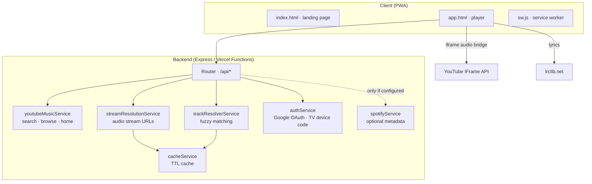

# 🎵 Preluded

**An open-source music player PWA with an Apple Music-inspired interface.**
Installable on your phone or desktop, synced lyrics, and one-click Google sign-in to bring your YouTube Music playlists with you.

**[▶ Try it live](https://preluded.vercel.app)** · [Features](#-features) · [Run it locally](#-quick-start) · [Privacy](https://preluded.vercel.app/privacy) · [Terms](https://preluded.vercel.app/tos)

<!-- Add a screenshot or GIF here, for example:

-->

---

## ✨ Features

**Listening**
- Search for songs, artists and albums
- Artist pages with top songs, discography and similar artists
- Album and playlist pages
- Home feed with YouTube Music **Quick Picks**
- Queue, volume, playback speed and sleep timer
- Lock-screen and notification controls through the Media Session API, plus a background-audio workaround for iOS

**Lyrics**
- Time-synced lyrics from [lrclib.net](https://lrclib.net)
- Optional line-by-line translation to Italian

**Your library**
- Sign in with **Google** (read-only YouTube access) and import your playlists and liked songs
- Or skip sign-in and import any public playlist by pasting a YouTube / YouTube Music link
- Optional YouTube Music session for personalised mixes
- Local playlists, liked songs and listening history, stored in your browser's `localStorage`

**Sharing**
- Share a track with a deep link that opens a "listen now" banner for the recipient

**Installable**
- Web app manifest and service worker, so it can be added to the home screen and runs standalone

## 📱 Platforms

| Platform | Status |
| :--- | :--- |
| Web / PWA | Live |
| iOS / macOS | Coming soon |
| Android | Coming soon |
| Windows / Linux | Coming soon |

Native builds are in development. Until then, the PWA works on all of them.

---

## 🧩 How it works



- **Frontend:** two static pages, `index.html` (landing) and `app.html` (the player, served at `/app`). No build step.
- **Backend:** an Express app that also runs unchanged as Vercel Serverless Functions (`api/index.js` re-exports it).
- **Playback:** the player can use a hidden YouTube IFrame player as an audio bridge, or a direct audio stream resolved by the backend (`/api/stream`, `/api/stream-url`). Stream URLs expire, so they are cached with a TTL and re-resolved when needed.
- **Sign-in:** Google OAuth (read-only YouTube scope) and the YouTube TV device-code flow. Tokens live in the browser, not on the server.
- **Offline catalog:** a small built-in catalog lets the app start and respond even with no configuration.
- **Spotify (legacy, optional):** if `SPOTIFY_*` keys are set, the backend can use the Spotify Web API for metadata. The app UI does **not** offer Spotify sign-in.

---

## 🚀 Quick start

```bash
git clone https://github.com/mrbana69/web-music.git
cd web-music
npm install
cp .env.example .env
npm start
```

Then open <http://localhost:3000>. Tested on Node.js 22.

The app starts without any keys. Add the following to `.env` to enable more:

| Variable | Needed for |
| :--- | :--- |
| `GOOGLE_CLIENT_ID`, `GOOGLE_CLIENT_SECRET`, `GOOGLE_REDIRECT_URI` | Google sign-in and importing your playlists ([Google Cloud Console](https://console.cloud.google.com/apis/credentials)) |
| `YTM_COOKIE` | Optional server-wide YouTube Music session |
| `SPOTIFY_CLIENT_ID`, `SPOTIFY_CLIENT_SECRET`, `SPOTIFY_REDIRECT_URI` | Optional, legacy Spotify metadata |
| `PORT`, `NODE_ENV`, `CORS_ORIGIN` | Server settings |
| `RESOLVER_CACHE_TTL`, `STREAM_CACHE_TTL`, `METADATA_CACHE_TTL` | Cache lifetimes in seconds |
| `SESSION_SECRET` | Set this to a random value in production |

### Deploy on Vercel

Import the repo in Vercel and add the same environment variables. `vercel.json` already routes `/app`, `/privacy`, `/tos` and `/api/*`.

### Checks

```bash
npm run check      # syntax-checks the inline scripts in index.html and app.html
npm run test:api   # runs the API contract tests
```

---

## 📡 API reference

| Endpoint | Description |
| :--- | :--- |
| `GET /health` | Health check and cache status |
| `GET /api/search` | Search (`s` track, `a` artist, `al` album, or `q`) |
| `GET /api/info` | Track metadata (`id`) |
| `GET /api/track` | Playable stream manifest for a track (`id`, `quality`) |
| `GET /api/stream`, `/api/audio` | Audio stream for the player |
| `GET /api/stream-url` | Direct audio URL with TTL (`videoId`) |
| `GET /api/resolve` | Match a title/artist to a YouTube video (`title`, `artist`, `duration_ms`) |
| `GET /api/mix` | Recommendations and radio for a track |
| `GET /api/home`, `/api/quick-picks` | Home feed and Quick Picks |
| `GET /api/artist`, `/api/artist/similar` | Artist details and similar artists |
| `GET /api/album`, `/api/playlist` | Album and playlist contents |
| `GET /api/auth/google/login` | Start Google sign-in |
| `GET /api/auth/google/library` | Import playlists and liked songs (authenticated) |
| `GET /api/auth/yt/get-code`, `/verify-code` | YouTube TV device-code flow |
| `GET /api/auth/session` | Connection state |

The Spotify auth routes (`/api/auth/spotify/*`) still exist in the backend but are not used by the app.

---

## 📂 Project structure

```
web-music/
├── index.html            # Landing page
├── app.html              # The player (served at /app)
├── privacy.html, tos.html
├── manifest.json, sw.js  # PWA manifest and service worker
├── server.js             # Express entry point
├── api/index.js          # Vercel Serverless entry point
├── vercel.json           # Routes and rewrites
├── config/env.js         # Environment loader
├── middleware/           # CORS, auth extraction, logging, error handling
├── routes/               # /api route definitions
├── controllers/          # Request handlers
├── services/             # YouTube Music, streams, resolver, auth, Spotify, cache
├── lib/                  # Fuzzy matcher, HTTP client, offline catalog, helpers
├── tools/                # Test and debugging scripts
├── icons/                # PWA icons
└── mvp.md                # Original design notes (in Italian)
```

---

## ⚠️ Disclaimer

Preluded is an independent hobby project. It is **not affiliated with, endorsed by, or sponsored by** YouTube, Google or Spotify.

To search and play audio, the backend talks to YouTube's **unofficial, undocumented Innertube endpoints**, not to a licensed music API. This may conflict with the [YouTube Terms of Service](https://www.youtube.com/t/terms) and can stop working at any time. All music, artwork and lyrics belong to their respective rights holders.

It is provided for **personal, non-commercial, educational use**, as is and without warranty. If you deploy your own instance, you are responsible for how you use it.

---

## 📄 License

[GPL-3.0](LICENSE)
